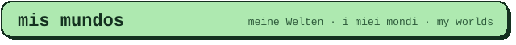
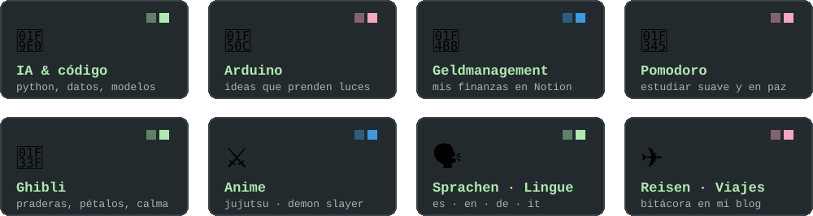
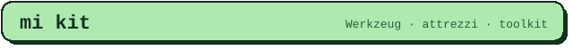
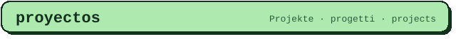
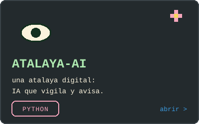
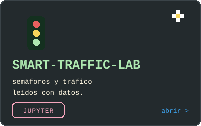
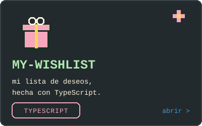
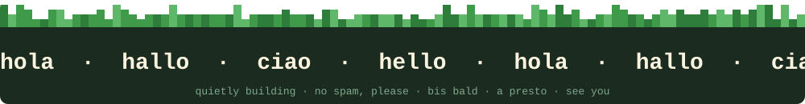

Hola · Hallo · Ciao · Hello 👋 Soy **Edison** (también *Bayardito*).

Me muevo entre **IA, código y Arduino**, organizo mi vida en dashboards de Notion, me encantan las praderas de Ghibli y el anime, y hablo **español, English, Deutsch e italiano**. Tengo tantas ideas a la vez que este perfil es más un jardín que una oficina 🌱

> **es** construyendo en silencio · **de** ich baue leise · **it** costruisco in silenzio · **en** quietly building

✈️ Mi bitácora de viajes: [misviajesedi.blogspot.com](https://misviajesedi.blogspot.com/)

  
  
  

